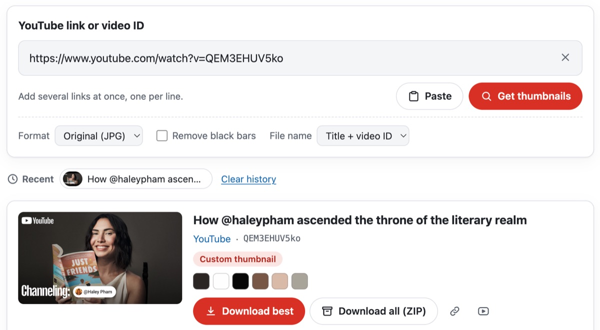
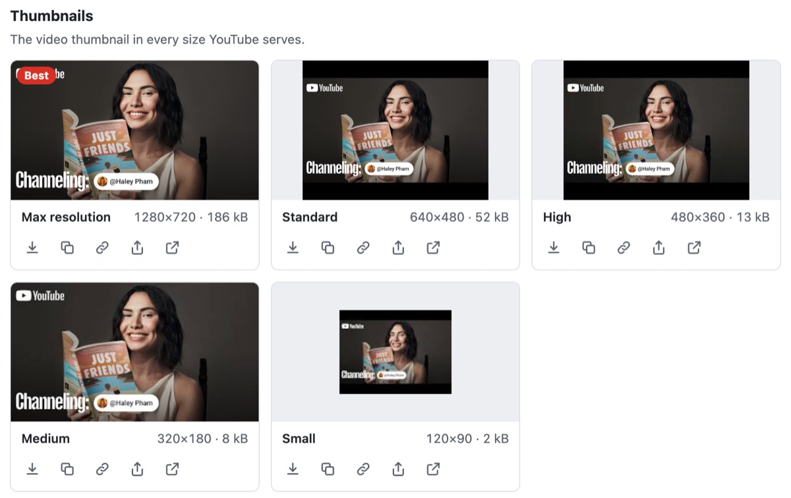
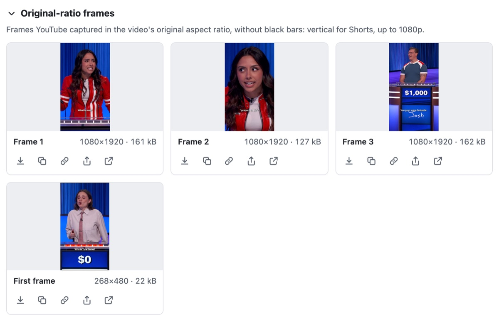
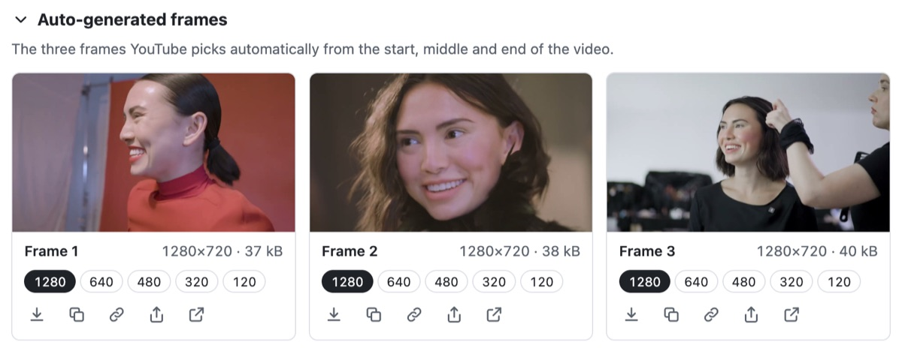
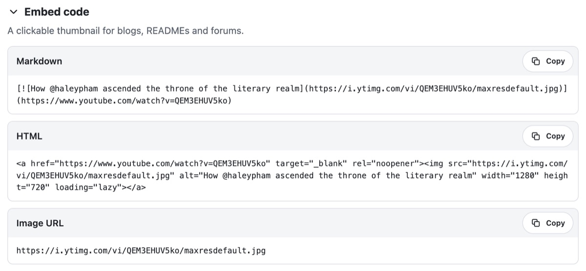

<p align="center"></p>

<h1 align="center">أداة لاستخراج الصور المصغرة والإطارات من YouTube على الويب</h1>

<p align="center">
  
  
  
  
  <a href="../LICENSE"></a>
</p>

<p align="center"><a href="../README.md">English</a> · <a href="README.ko.md">한국어</a> · <b>العربية</b> · <a href="README.de.md">Deutsch</a> · <a href="README.es.md">Español (España)</a> · <a href="README.es-419.md">Español (Latinoamérica)</a> · <a href="README.fr.md">Français</a> · <a href="README.id.md">Bahasa Indonesia</a> · <a href="README.it.md">Italiano</a> · <a href="README.ja.md">日本語</a> · <a href="README.pl.md">Polski</a> · <a href="README.pt-BR.md">Português (Brasil)</a> · <a href="README.pt-PT.md">Português (Portugal)</a> · <a href="README.ru.md">Русский</a> · <a href="README.th.md">ไทย</a> · <a href="README.vi.md">Tiếng Việt</a> · <a href="README.zh-Hans.md">简体中文</a> · <a href="README.zh-Hant.md">繁體中文</a></p>

مكوّن ويب يستقبل روابط YouTube ويعثر على كل الصور التي يوفرها YouTube لكل فيديو، من الصورة المصغرة بكل أحجامها، إلى الإطارات بنسبة الفيديو نفسه، والإطارات التي يختارها YouTube بنفسه، لتنزيلها أو نسخها أو تحويلها أو حفظها في ملف ZIP. يعمل بالكامل داخل المتصفح: بلا خادم وبلا مفتاح API.

<p align="center"></p>

| الصور | الملفات | الحجم | أي الفيديوهات |
|---|---|---|---|
| الصورة المصغرة | `maxresdefault` · `sddefault` · `hqdefault` · `mqdefault` · `default`، و`hq720` عند غياب `maxresdefault` | من ⁦1280×720⁩ إلى ⁦120×90⁩ | كل الفيديوهات؛ الأحجام 4:3 فيها أشرطة سوداء، والفيديوهات المرفوعة بدقة منخفضة ليس لها ⁦1280×720⁩ ولا ⁦640×480⁩ |
| إطارات بالنسبة الأصلية | `oar1`–`oar3` و`frame0` (الإطار الأول) | ⁦1080×1920⁩ في Shorts، وحتى ⁦1920×1080⁩ في غيرها | Shorts والفيديوهات الأقدم؛ الفيديوهات العادية الحديثة ليس لها إلا `frame0` |
| الإطارات التلقائية | ⁦`1`–`3`⁩ بخمسة أحجام، أكبرها `maxres1`–`maxres3` | من ⁦1280×720⁩ إلى ⁦120×90⁩ | كل الفيديوهات ما عدا البث المباشر |
| إصدارات WebP | أحجام الصورة المصغرة، ضمن `vi_webp` | مثل الصورة المصغرة | تُعرض وتُفتح فقط — يرسلها YouTube بلا CORS |

لا يذكر YouTube أيّ هذه الملفات موجود، لذا يطلب ThumbSnap كل ملف ويقرأ الرد: الملف غير الموجود يعود بخطأ 404 مع صورة رمادية بديلة بحجم ⁦120×90⁩. ويقارن الصورة المصغرة بالإطارات التلقائية بايتًا بايتًا ليميّز الصورة المصغرة المرفوعة من المُنشأة تلقائيًا، ويأخذ العنوان والقناة وما إذا كان الفيديو عموديًا من نقطة oEmbed في YouTube. ما كشفه استكشاف YouTube مدوَّن في [docs/youtube-thumbnails.md](youtube-thumbnails.md).

تتوفر الأداة بـ 18 لغة: الإنجليزية والكورية واليابانية والصينية (المبسطة والتقليدية) والألمانية والإسبانية (إسبانيا وأمريكا اللاتينية) والفرنسية والإيطالية والبرتغالية (البرتغال والبرازيل) والبولندية والروسية والتايلاندية والعربية والإندونيسية والفيتنامية، وتتبع لغة الصفحة التي توضع فيها. وفي أي لغة أخرى تظهر بالإنجليزية. ويتبع الوضع الفاتح أو الداكن إعداد الجهاز، أو وضع الصفحة نفسها حين تمرره إليها.

شيفرة المصدر في هذا المستودع مرخّصة بموجب رخصة MIT. اسم ThumbSnap وأيقونته ليسا جزءًا من هذه الشيفرة. الأيقونة في الأعلى معروضة للاستدلال فقط: لا تشملها رخصة MIT، ولا تتضمنها النسخ المبنية من هذا المستودع. لا علاقة لـ ThumbSnap بـ YouTube أو Google، والصور المصغرة ملك لأصحابها.

## جرّبها

يعمل ThumbSnap على [hobbyworker.me](https://hobbyworker.me/ar/services/thumbsnap/) بجميع اللغات الـ 18.

## المتطلبات

- متصفح حديث: Chrome أو Edge الإصدار 111 أو أحدث، وSafari 16.4 أو أحدث، وFirefox 113 أو أحدث.
- الوصول إلى `i.ytimg.com` (الصور) و`www.youtube.com` (oEmbed). لا يُتصل بأي عنوان آخر.
- يتطلب نسخ الصور والمشاركة صفحة آمنة: HTTPS أو `localhost`.

## البناء

```sh
npm install
npm run dev     # صفحة العرض التجريبي، مع مبدّلات اللغة والمظهر
npm test        # اختبارات الوحدات (Vitest)
npm run build   # dist/thumbsnap.js وخريطة المصدر وTHIRD_PARTY_LICENSES.txt
```

جرى التحقق من البناء والاختبارات على Node.js 24.

الملف `dist/thumbsnap.js` وحدة ES واحدة تتضمن Lit وتسجّل `<thumb-snap>` عند تحميلها. وزّع `THIRD_PARTY_LICENSES.txt` معها.

## الاستخدام

1. الصق رابطًا أو أكثر من YouTube أو معرّفات فيديو. تعمل روابط watch و`youtu.be` وShorts وlive وembed و`music.youtube.com`، وقائمة التشغيل تجلب فيديو غلافها. الرابط الملصوق يُحمَّل فورًا؛ وللروابط المتعددة ضع كل رابط في سطر، أو اسحب رابطًا وأفلته على الأداة.
2. تظهر الصورة المصغرة بكل الأحجام المتوفرة لدى YouTube، مع أبعادها الحقيقية وحجم ملفها، ويُعلَّم أكبرها بـ **الأفضل**.
   <p align="center"></p>
3. **إطارات بالنسبة الأصلية** هي ما التقطه YouTube بشكل الفيديو نفسه، ففي مقطع Short تجد ثلاثة إطارات عمودية بحجم ⁦1080×1920⁩ وإطاره الأول.
   <p align="center"></p>
4. **الإطارات التلقائية** هي الإطارات الثلاثة التي يختارها YouTube بنفسه، والأرقام تحت كل منها تبدّل بين أحجامه الخمسة.
   <p align="center"></p>
5. يمكن تنزيل كل صورة، أو نسخها كصورة، أو نسخ عنوانها، أو مشاركتها حيث يستطيع الجهاز مشاركة الملفات، أو فتحها. يشمل **تنزيل الأفضل** و**تنزيل الكل (ZIP)** الفيديو كاملًا؛ ومع عدة فيديوهات يضع **تنزيل كل الفيديوهات (ZIP)** كل فيديو في مجلد خاص به.
6. يحوّل **التنسيق** إلى PNG أو WebP (لا يُعرض إلا ما يستطيع المتصفح ترميزه)، ويقص **إزالة الأشرطة السوداء** الأشرطة من صور 4:3، ويستخدم **اسم الملف** معرّف الفيديو، أو العنوان والمعرّف.
7. يعطي **رمز التضمين** شيفرة Markdown وHTML لصورة مصغرة قابلة للنقر. يحتفظ شريط العنوان بـ `?v=` فيمكن مشاركة النتيجة، وتبقى الفيديوهات الأخيرة محفوظة في المتصفح.
   <p align="center"></p>

## الاستخدام في صفحة ويب

```html
<script type="module" src="thumbsnap.js"></script>
<thumb-snap></thumb-snap>
```

| السمة | القيمة الافتراضية | |
|---|---|---|
| `locale` | أقرب سمة `lang` | `en` `ko` `ja` `zh-hans` `zh-hant` `id` `es` (إسبانيا) `es-419` (أمريكا اللاتينية) `fr` `pt` (البرتغال) `pt-br` (البرازيل) `vi` `de` `it` `pl` `ru` `th` `ar`؛ وتُطابَق الوسوم مثل `zh-TW` أو `pt-BR` مع اللغة المناسبة |
| `value` | | روابط أو معرّفات تُحمَّل عند البدء |
| `no-url-sync` | معطّل | لا يغيّر `?v=` و`?list=` في شريط العنوان |
| `no-history` | معطّل | لا يحتفظ بالفيديوهات الأخيرة في `localStorage` |
| `max-videos` | `20` | أقصى عدد من الفيديوهات يُحمَّل دفعة واحدة |

- الوضع الفاتح أو الداكن يأتي من خاصية CSS `color-scheme`، وافتراضيًا من إعداد الجهاز. ولكي تتبع الأداة الوضع الداكن للصفحة، أعطِ العنصر قيمة لها: `thumb-snap { color-scheme: inherit; }` يأخذ قيمة الصفحة، أو `thumb-snap { color-scheme: dark; }` ما دامت الصفحة داكنة. المتصفحات التي لا تدعم `light-dark()` (Chrome وEdge قبل 123، وFirefox قبل 120، وSafari قبل 17.5) تعرض الألوان الفاتحة.
- خصائص CSS المخصصة: `--thumbsnap-accent` و`--thumbsnap-accent-hover` و`--thumbsnap-radius` و`--thumbsnap-font`.
- كل إجراء يطلق حدث `thumbsnap` متصاعدًا (bubbling) ومركّبًا (composed). قيمة `detail` فيه هي `{ action, videoId?, variant?, format?, count? }`، و`action` واحدة من `resolve` و`download` و`download-zip` و`copy-image` و`copy-text` و`share` و`error`.
- الدالة `load(text)` تحمّل الروابط كأنها كُتبت يدويًا، و`clear()` تفرغ الأداة.

يمكن لفئة فرعية أن ترتّب الأداة بنفسها. تتكوّن `render()` من جزأين: `renderTop()` (حقل الرابط وخياراته) و`renderBottom()` (الفيديوهات الأخيرة والنتائج والإشعار وعارض الصور)، ولكل جزء تباعده الخاص، فيمكن إعادة تجميعهما مع أي شيء قبلهما أو بينهما أو بعدهما:

```js
import { ThumbSnapElement, defineThumbSnap, html } from './src/index.ts';

class MyThumbSnap extends ThumbSnapElement {
  render() {
    return html`${this.renderTop()}<slot name="between"></slot>${this.renderBottom()}`;
  }
}
defineThumbSnap('thumb-snap', MyThumbSnap);
```

لا يسجّل `src/index.ts` شيئًا، لذا يمكن للفئة الفرعية أن تأخذ الاسم `thumb-snap`. الفتحة (slot) الفارغة لا تشغل مساحة، وما يوضع فيها يأخذ تباعد بقية الأداة نفسه.

اللبنات الأساسية، مثل `parseTarget` و`extractTargets` و`imageUrl` و`loadImage` و`fetchOEmbed` و`transformImage` و`findContentRect` و`extractPalette` و`createZip` وغيرها، مُصدَّرة أيضًا لاستخدامها من دون الواجهة.

## البنية

```
src/
├── core/       الروابط، وملفات CDN، والتحميل والفحص، وoEmbed، والقص، والتحويل والألوان، وZIP، وأسماء الملفات (بلا واجهة)
├── i18n/       en (الأصل), ko, ja, zh-hans, zh-hant, id, es, es-419, fr, pt, pt-br, vi, de, it, pl, ru, th, ar
├── ui/         العنصر <thumb-snap> (Lit): لغة الصفحة، وحالة الفيديو الواحد، والقوالب، والأنماط
├── index.ts    الواجهة البرمجية العامة؛ لا تسجّل شيئًا
└── auto.ts     نقطة دخول الحزمة؛ تسجّل <thumb-snap>
tests/          Vitest: الروابط، والملفات، وZIP، والقص، وoEmbed، والكتالوجات، واختيار أفضل حجم
docs/           ما يوفره YouTube، وملفات README هذه
index.html      صفحة العرض التجريبي
```

لكل الكتالوجات المفاتيح والعناصر النائبة نفسها الموجودة في `en.ts`؛ ويتأكد من ذلك مدقق الأنواع والاختبارات.

## القيود

- لا يوثّق YouTube أيًّا من هذه الملفات. ما هو موجود، وأين، قد يتغير.
- تُميَّز الصورة المصغرة المرفوعة من التلقائية بمقارنة البايتات مع `hq1`–`hq3`. وإذا اختار صاحب القناة اقتراحًا آخر من اقتراحات Studio، فستبدو الصورة كأنها مرفوعة أيضًا.
- ملفات WebP من YouTube يمكن فتحها فقط: من دون CORS لا تستطيع الصفحة حفظها أو تحويلها. وتحويل JPEG إلى WebP يعطي النتيجة نفسها.
- الملفات التي تحتاج إلى توقيعات YouTube، مثل الغلاف العمودي لمقطع Short والمعاينات المتحركة ولوحات القصة، وكذلك قوائم التشغيل أو القنوات الكاملة، بعيدة المنال من دون خادم.
- يترك فحص الملفات غير الموجودة أخطاء 404 في وحدة تحكم المتصفح.
