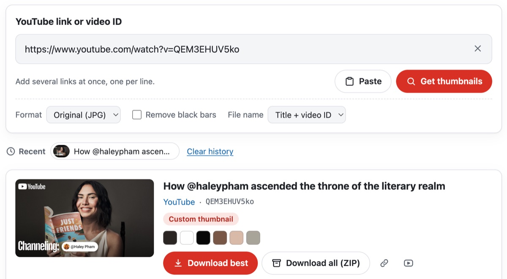
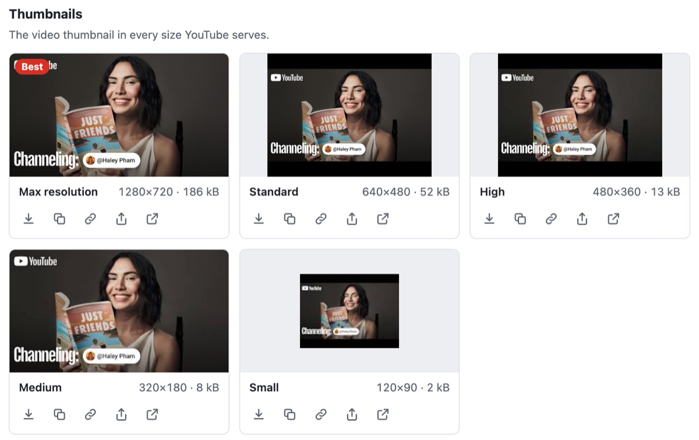
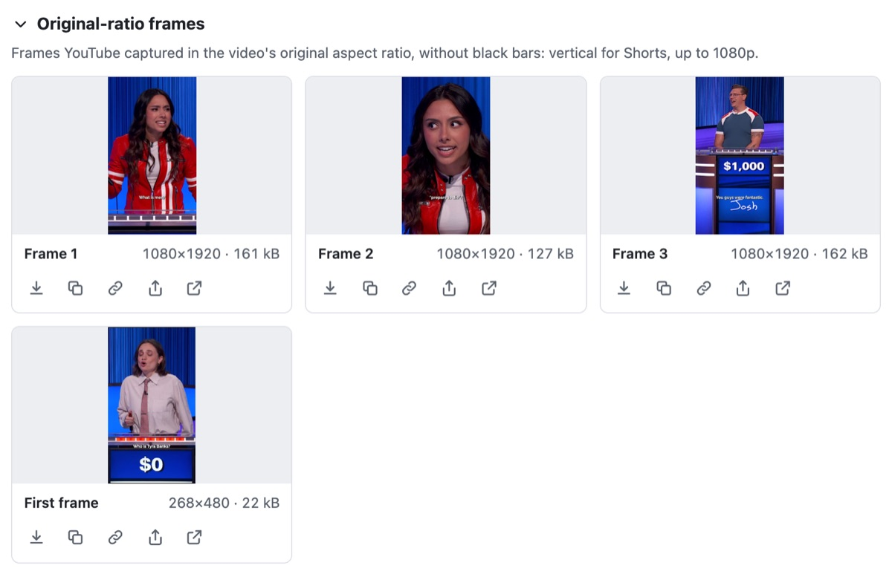
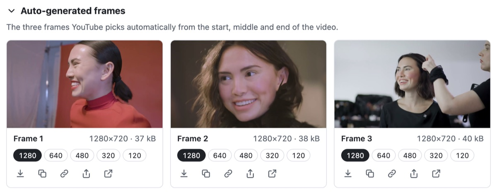
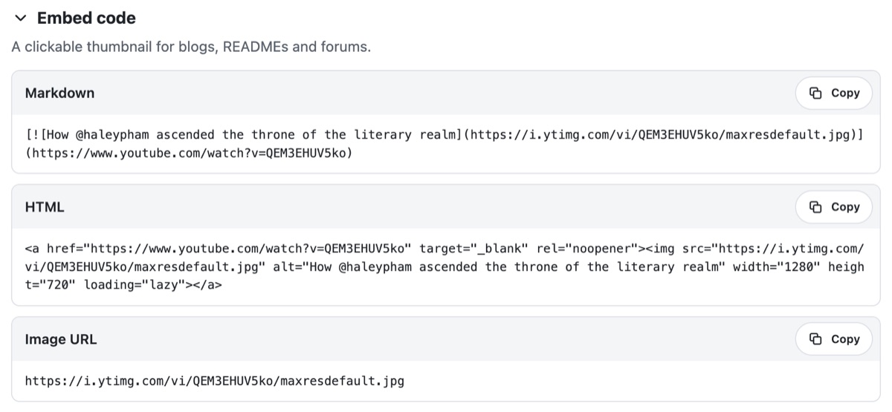

<p align="center"></p>

<h1 align="center">Extractor de miniaturas y cuadros de YouTube para la web</h1>

<p align="center">
  
  
  
  
  <a href="../LICENSE"></a>
</p>

<p align="center"><a href="../README.md">English</a> · <a href="README.ko.md">한국어</a> · <a href="README.de.md">Deutsch</a> · <a href="README.es.md">Español (España)</a> · <b>Español (Latinoamérica)</b> · <a href="README.fr.md">Français</a> · <a href="README.id.md">Bahasa Indonesia</a> · <a href="README.it.md">Italiano</a> · <a href="README.ja.md">日本語</a> · <a href="README.pl.md">Polski</a> · <a href="README.pt-BR.md">Português (Brasil)</a> · <a href="README.pt-PT.md">Português (Portugal)</a> · <a href="README.ru.md">Русский</a> · <a href="README.th.md">ไทย</a> · <a href="README.vi.md">Tiếng Việt</a> · <a href="README.zh-Hans.md">简体中文</a> · <a href="README.zh-Hant.md">繁體中文</a></p>

Un componente web que recibe enlaces de YouTube y encuentra todas las imágenes que YouTube ofrece de cada video —la
miniatura en todos sus tamaños, cuadros con la relación de aspecto del propio video y los cuadros que YouTube elige
por sí solo— para descargarlas, copiarlas, convertirlas o guardarlas en un ZIP. Funciona por completo en el navegador:
sin servidor ni clave de API.

<p align="center"></p>

| Imágenes | Archivos | Tamaño | En qué videos |
|---|---|---|---|
| Miniatura | `maxresdefault` · `sddefault` · `hqdefault` · `mqdefault` · `default`, más `hq720` cuando falta `maxresdefault` | de 1280×720 a 120×90 | todos los videos; los tamaños 4:3 llevan barras negras y los videos subidos en baja resolución no tienen 1280×720 ni 640×480 |
| Cuadros en proporción original | `oar1`–`oar3` y `frame0` (el primer cuadro) | 1080×1920 en los Shorts; en los demás, hasta 1920×1080 | Shorts y videos más antiguos; los videos normales recientes solo tienen `frame0` |
| Cuadros automáticos | `1`–`3` en cinco tamaños; los más grandes son `maxres1`–`maxres3` | de 1280×720 a 120×90 | todos los videos excepto las transmisiones en vivo |
| Versiones WebP | los tamaños de la miniatura, en `vi_webp` | como la miniatura | solo se muestran y se abren — YouTube las envía sin CORS |

YouTube no indica cuáles de estos archivos existen, así que ThumbSnap pide cada uno y lee la respuesta: los que faltan
devuelven un 404 con una imagen gris de relleno de 120×90. Compara byte a byte la miniatura con los cuadros
automáticos para distinguir una miniatura subida de una generada automáticamente, y obtiene del endpoint oEmbed de
YouTube el título, el canal y si el video es vertical. Lo que se averiguó sondeando YouTube está documentado en
[docs/youtube-thumbnails.md](youtube-thumbnails.md).

La herramienta está disponible en 17 idiomas: inglés, coreano, japonés, chino (simplificado y tradicional), alemán,
español (de España y de Latinoamérica), francés, italiano, portugués (de Portugal y de Brasil), polaco, ruso,
tailandés, indonesio y vietnamita. Sigue el idioma de la página en la que está; en cualquier otro idioma, aparece en
inglés. El modo claro u oscuro sigue la configuración del dispositivo, o el modo oscuro de la página cuando la página
se lo pasa.

El código fuente de este repositorio tiene licencia MIT. El nombre ThumbSnap y su ícono no están incluidos en este
código. El ícono de arriba se muestra solo como referencia: no está cubierto por la licencia MIT y lo que compiles
desde este repositorio no lo incluye. ThumbSnap no tiene relación con YouTube ni con Google, y las miniaturas
pertenecen a sus creadores.

## Pruébalo

ThumbSnap funciona en [hobbyworker.me](https://hobbyworker.me/es-419/services/thumbsnap/), en los 17 idiomas.

## Requisitos

- Un navegador actual: Chrome o Edge 111 o posterior, Safari 16.4 o posterior, Firefox 113 o posterior.
- Acceso a `i.ytimg.com` (imágenes) y `www.youtube.com` (oEmbed). No se conecta a ningún otro sitio.
- Para copiar imágenes y compartir hace falta una página segura: HTTPS o `localhost`.

## Compilación

```sh
npm install
npm run dev     # la página de demostración, con selectores de idioma y tema
npm test        # pruebas unitarias (Vitest)
npm run build   # dist/thumbsnap.js, su source map y THIRD_PARTY_LICENSES.txt
```

La compilación y las pruebas se verificaron con Node.js 24.

`dist/thumbsnap.js` es un único módulo ES que incluye Lit y registra `<thumb-snap>` al cargarse. Distribúyelo junto
con `THIRD_PARTY_LICENSES.txt`.

## Uso

1. Pega uno o varios enlaces de YouTube o ID de video. Sirven los enlaces watch, `youtu.be`, Shorts, live, embed y
   `music.youtube.com`, y de una playlist se toma su video de portada. Un enlace pegado se carga de inmediato; si son
   varios, pon uno por línea. También puedes arrastrar un enlace y soltarlo sobre la herramienta.
2. La miniatura aparece en todos los tamaños que tiene YouTube, cada uno con sus dimensiones reales y su tamaño de
   archivo, y el más grande se marca como **Mejor**.
   <p align="center"></p>
3. En **Cuadros en proporción original** está lo que YouTube capturó con la forma del propio video: en un Short, tres
   cuadros verticales de 1080×1920 y su primer cuadro.
   <p align="center"></p>
4. En **Cuadros automáticos** están los tres cuadros que YouTube elige por sí solo; los números debajo de cada uno
   permiten cambiar entre sus cinco tamaños.
   <p align="center"></p>
5. Cada imagen se puede descargar, copiar como imagen, copiar su dirección, compartir (si el dispositivo puede
   compartir archivos) o abrir. **Descargar la mejor** y **Descargar todo (ZIP)** se aplican al video entero; con
   varios videos, **Descargar todos los videos (ZIP)** pone cada uno en su propia carpeta.
6. **Formato** convierte a PNG o WebP (solo se ofrece lo que el navegador puede codificar), **Quitar barras negras**
   las recorta de las imágenes 4:3 y **Nombre del archivo** usa el ID del video, o el título y el ID.
7. **Código para insertar** da el Markdown y el HTML de una miniatura con enlace. La barra de direcciones conserva
   `?v=`, así que un resultado se puede compartir, y los videos recientes se quedan guardados en el navegador.
   <p align="center"></p>

## Uso en una página web

```html
<script type="module" src="thumbsnap.js"></script>
<thumb-snap></thumb-snap>
```

| Atributo | Predeterminado | |
|---|---|---|
| `locale` | el atributo `lang` más cercano | `en` `ko` `ja` `zh-hans` `zh-hant` `id` `es` (España) `es-419` (Latinoamérica) `fr` `pt` (Portugal) `pt-br` (Brasil) `vi` `de` `it` `pl` `ru` `th`; las etiquetas como `zh-TW` o `pt-BR` se asignan al idioma correspondiente |
| `value` | | enlaces o ID que se cargan al inicio |
| `no-url-sync` | desactivado | no toca `?v=` ni `?list=` en la barra de direcciones |
| `no-history` | desactivado | no guarda videos recientes en `localStorage` |
| `max-videos` | `20` | el máximo de videos que se cargan de una vez |

- El modo claro u oscuro sale de `color-scheme` de CSS: por defecto, la configuración del dispositivo. Para seguir el
  modo oscuro de la página, dale al elemento un `color-scheme`: `thumb-snap { color-scheme: inherit; }` toma el de la
  página, o pon `thumb-snap { color-scheme: dark; }` mientras la página esté en oscuro. Los navegadores sin
  `light-dark()` (Chrome y Edge anteriores a la 123, Firefox anterior a la 120, Safari anterior a la 17.5) muestran
  los colores claros.
- Propiedades personalizadas de CSS: `--thumbsnap-accent`, `--thumbsnap-accent-hover`, `--thumbsnap-radius`,
  `--thumbsnap-font`.
- Cada acción dispara un evento `thumbsnap` con `bubbles` y `composed` activados. Su `detail` es
  `{ action, videoId?, variant?, format?, count? }`, y `action` es `resolve`, `download`, `download-zip`,
  `copy-image`, `copy-text`, `share` o `error`.
- `load(text)` carga enlaces como si se hubieran escrito; `clear()` vacía la herramienta.

Una subclase puede organizar la herramienta a su manera. `render()` se compone de dos partes —`renderTop()` (el campo
del enlace y sus opciones) y `renderBottom()` (los videos recientes, los resultados, la notificación y el visor de
imágenes)— y cada parte trae su propio espaciado, así que se pueden volver a juntar con lo que quieras antes, entre o
después de ellas:

```js
import { ThumbSnapElement, defineThumbSnap, html } from './src/index.ts';

class MyThumbSnap extends ThumbSnapElement {
  render() {
    return html`${this.renderTop()}<slot name="between"></slot>${this.renderBottom()}`;
  }
}
defineThumbSnap('thumb-snap', MyThumbSnap);
```

`src/index.ts` no registra nada, así que la subclase puede usar el nombre `thumb-snap`. Un slot vacío no ocupa espacio
y lo que pongas dentro queda espaciado como el resto de la herramienta.

Las piezas básicas —`parseTarget`, `extractTargets`, `imageUrl`, `loadImage`, `fetchOEmbed`, `transformImage`,
`findContentRect`, `extractPalette`, `createZip` y más— también se exportan, para usarlas sin la interfaz.

## Estructura

```
src/
├── core/       enlaces, los archivos de la CDN, carga y sondeo, oEmbed, recorte, conversión y colores, ZIP, nombres de archivo (sin interfaz)
├── i18n/       en (original), ko, ja, zh-hans, zh-hant, id, es, es-419, fr, pt, pt-br, vi, de, it, pl, ru, th
├── ui/         el elemento <thumb-snap> (Lit) — el idioma de la página, el estado de un video, plantillas, estilos
├── index.ts    la API pública; no registra nada
└── auto.ts     el punto de entrada del bundle; registra <thumb-snap>
tests/          Vitest — enlaces, archivos, ZIP, recorte, oEmbed, los catálogos, la elección del mejor tamaño
docs/           lo que ofrece YouTube y estos README
index.html      la página de demostración
```

Todos los catálogos tienen las mismas claves y marcadores de posición que `en.ts`; el verificador de tipos y las
pruebas se encargan de verificarlo.

## Limitaciones

- YouTube no documenta ninguno de estos archivos. Lo que existe, y dónde, puede cambiar.
- Una miniatura subida se distingue de una automática comparando sus bytes con `hq1`–`hq3`. Si el creador eligió otra
  de las sugerencias de Studio, también parecerá una miniatura subida.
- Los archivos WebP de YouTube solo se pueden abrir: sin CORS, la página no puede guardarlos ni convertirlos.
  Convertir un JPEG a WebP da el mismo resultado.
- Los archivos que necesitan firmas de YouTube —la portada vertical de un Short, las vistas previas animadas, los
  storyboards— y las playlists o canales completos quedan fuera de alcance sin un servidor.
- Verificar archivos que no existen deja errores 404 en la consola del navegador.
