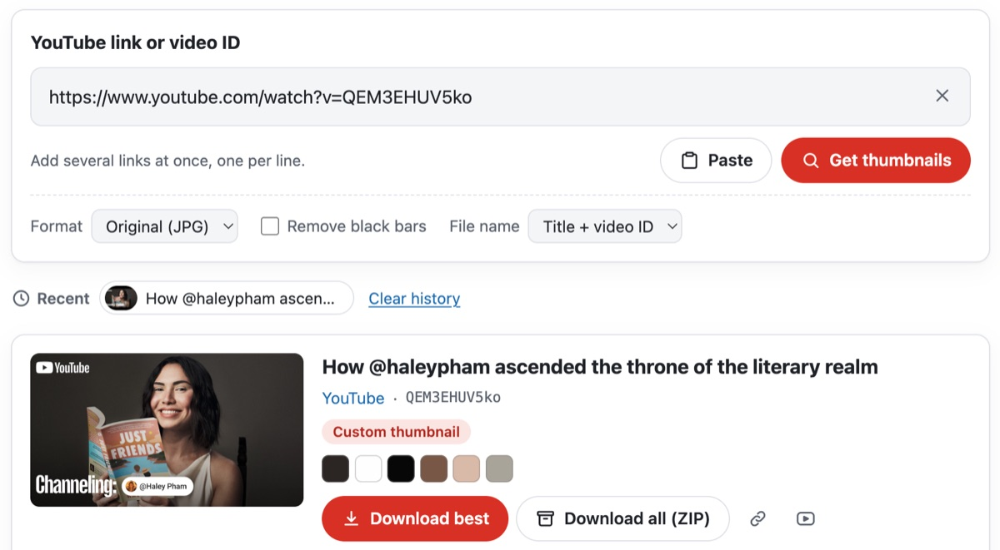
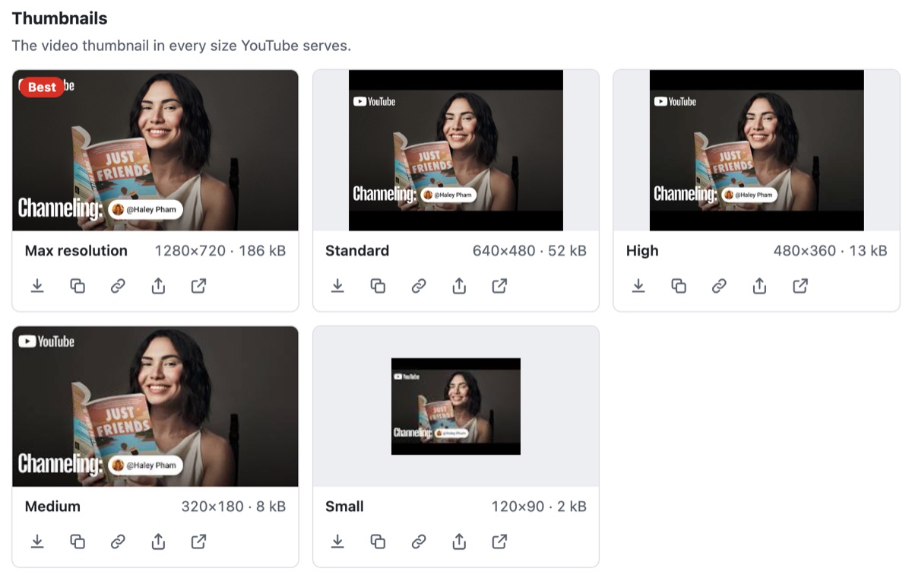
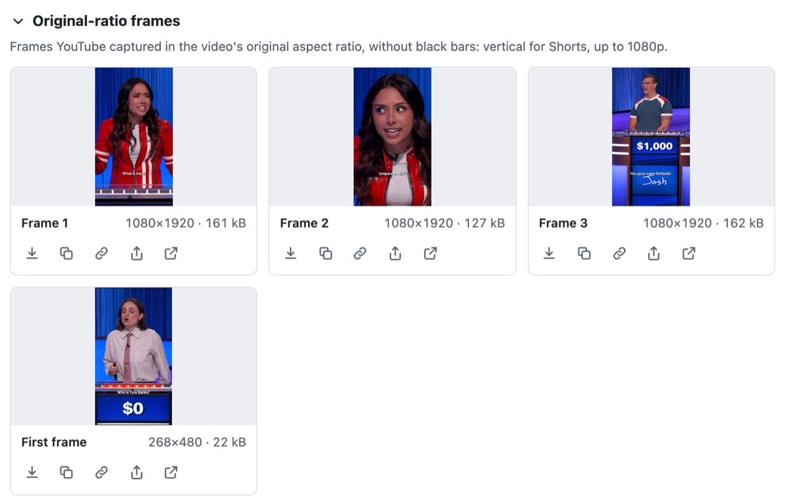
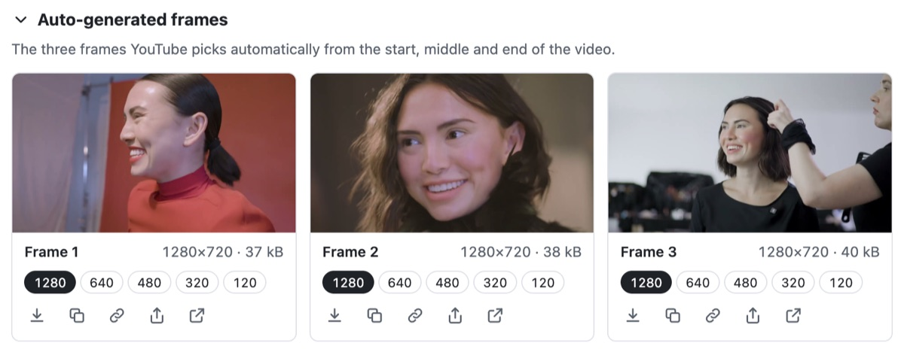
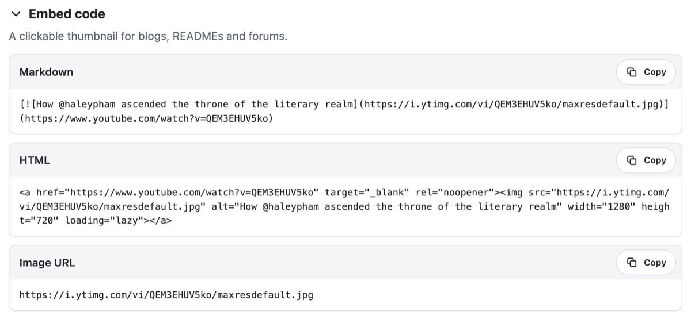

<p align="center"></p>

<h1 align="center">Web用YouTubeサムネイル・フレーム抽出ツール</h1>

<p align="center">
  
  
  
  
  <a href="../LICENSE"></a>
</p>

<p align="center"><a href="../README.md">English</a> · <a href="README.ko.md">한국어</a> · <a href="README.de.md">Deutsch</a> · <a href="README.es.md">Español</a> · <a href="README.fr.md">Français</a> · <a href="README.id.md">Bahasa Indonesia</a> · <a href="README.it.md">Italiano</a> · <b>日本語</b> · <a href="README.pl.md">Polski</a> · <a href="README.pt-BR.md">Português (Brasil)</a> · <a href="README.vi.md">Tiếng Việt</a> · <a href="README.zh-Hans.md">简体中文</a> · <a href="README.zh-Hant.md">繁體中文</a></p>

YouTubeのリンクから、動画ごとにYouTubeが配信している画像をすべて見つけ出すWebコンポーネントです。各サイズのサムネイル、動画本来のアスペクト比のフレーム、YouTubeが自動で選んだフレームを、ダウンロード・コピー・変換したり、ZIPにまとめて保存したりできます。ブラウザだけで動作し、サーバーもAPIキーも必要ありません。

<p align="center"></p>

| 画像 | ファイル | サイズ | 対象の動画 |
|---|---|---|---|
| サムネイル | `maxresdefault`・`sddefault`・`hqdefault`・`mqdefault`・`default`（`maxresdefault`がないときは`hq720`も） | 1280×720から120×90まで | すべての動画。4:3のサイズは上下に黒帯が入り、低解像度でアップロードされた動画には1280×720と640×480がない |
| オリジナル比率のフレーム | `oar1`–`oar3`と`frame0`（最初のフレーム） | ショートは1080×1920、それ以外は最大1920×1080 | ショートと古い動画。最近の通常の動画には`frame0`しかない |
| 自動生成フレーム | `1`–`3`の5サイズ（最大は`maxres1`–`maxres3`） | 1280×720から120×90まで | ライブ配信以外のすべての動画 |
| WebP 版 | サムネイルの各サイズ（`vi_webp`配下） | サムネイルと同じ | 表示して開けるだけ（YouTubeがCORSなしで送るため） |

YouTubeはこのうちどれが存在するかを示さないため、ThumbSnapはファイルを1つずつ要求し、その応答を読み取ります。存在しないファイルは、灰色の120×90のプレースホルダー画像を伴う404として返ってきます。また、サムネイルと自動生成フレームをバイト単位で比較して、アップロードされたサムネイルか自動生成されたものかを見分け、タイトル・チャンネル・縦長の動画かどうかはYouTubeのoEmbedエンドポイントから取得します。YouTubeを調べてわかったことは[docs/youtube-thumbnails.md](youtube-thumbnails.md)にまとめています。

このツールは13の言語で表示されます：英語・韓国語・日本語・中国語（簡体字・繁体字）・ドイツ語・スペイン語・フランス語・イタリア語・ポルトガル語・ポーランド語・インドネシア語・ベトナム語。置かれたページの言語に従い、それ以外の言語では英語で表示されます。ページのダークモードにも従います。

このリポジトリのソースはMITライセンスです。ThumbSnapという名前とそのアイコンは、このソースに含まれていません。冒頭のアイコンは紹介のために置いた画像で、MITライセンスの対象外です。このリポジトリからビルドしたものにも含まれません。ThumbSnapはYouTubeおよびGoogleとは関係がなく、サムネイルの権利は制作者に帰属します。

## 試してみる

ThumbSnapは[hobbyworker.me](https://hobbyworker.me/ja/tools/thumbsnap/)で公開しており、13の言語すべてで使えます。

## 動作環境

- 現行のブラウザ：ChromeまたはEdge 111以降、Safari 16.4以降、Firefox 113以降
- `i.ytimg.com`（画像）と`www.youtube.com`（oEmbed）にアクセスできること。それ以外とは通信しません。
- 画像のコピーと共有には、安全なページ（HTTPSまたは`localhost`）が必要です。

## ビルド

```sh
npm install
npm run dev     # デモページ（言語とテーマの切り替え付き）
npm test        # ユニットテスト（Vitest）
npm run build   # dist/thumbsnap.js・そのソースマップ・THIRD_PARTY_LICENSES.txt
```

Node.js 24でビルドとテストを確認しています。

`dist/thumbsnap.js`はLitを含む単一のESモジュールで、読み込まれると`<thumb-snap>`を登録します。配布するときは`THIRD_PARTY_LICENSES.txt`も一緒に含めてください。

## 使い方

1. YouTubeのリンクまたは動画IDを1つ以上貼り付けます。watch・`youtu.be`・ショート・ライブ・埋め込み・`music.youtube.com`のリンクに対応し、再生リストのリンクからはそのカバー動画が表示されます。貼り付けたリンクはすぐに読み込まれます。複数のときは1行に1つずつ入力するか、リンクをツールにドロップします。
2. サムネイルがYouTubeにあるすべてのサイズで並び、それぞれに実際のピクセルサイズとファイルサイズが表示されます。いちばん大きいものには**最高画質**の印が付きます。
   <p align="center"></p>
3. **オリジナル比率のフレーム**は、YouTubeが動画本来の形のままキャプチャしたフレームです。ショートなら、縦長の1080×1920のフレーム3枚と最初のフレームです。
   <p align="center"></p>
4. **自動生成フレーム**は、YouTubeが自動で選んだ3枚のフレームです。各フレームの下にある数字で、5つのサイズを切り替えられます。
   <p align="center"></p>
5. どの画像も、ダウンロードしたり、画像そのものやそのアドレスをコピーしたり、開いたりでき、ファイルを共有できるデバイスでは共有もできます。**最高画質をダウンロード**と **すべてダウンロード (ZIP)** は動画単位の操作です。動画が複数あるときは、**すべての動画をダウンロード (ZIP)** で動画ごとに別のフォルダに入れて保存できます。
6. **形式**ではPNGまたはWebPに変換できます（ブラウザがエンコードできる形式だけが表示されます）。**黒帯を除去**は4:3の画像から上下の黒帯を切り取ります。**ファイル名**では、動画IDか、タイトルとIDの組み合わせを使います。
7. **埋め込みコード**では、クリックできるサムネイルのMarkdownとHTMLが得られます。アドレスバーに`?v=`が残るので結果を共有でき、最近の動画はブラウザに保存されます。
   <p align="center"></p>

## ページへの組み込み

```html
<script type="module" src="thumbsnap.js"></script>
<thumb-snap></thumb-snap>
```

| 属性 | 既定値 | |
|---|---|---|
| `locale` | 最も近い`lang`属性 | `en` `ko` `ja` `zh-hans` `zh-hant` `id` `es` `fr` `pt` `vi` `de` `it` `pl`。`zh-TW`や`pt-BR`などのタグも対応する言語に割り当てる |
| `theme` | `auto` | `auto`は`<html>`の`data-theme`・`data-color-scheme`・`data-bs-theme`、`dark`または`light`クラス、`color-scheme`の順に従い、どれもなければシステムの設定に従う。`light`と`dark`はそのテーマに固定する |
| `value` | | 最初に読み込むリンクまたはID |
| `no-url-sync` | オフ | アドレスバーの`?v=`と`?list=`を変更しない |
| `no-history` | オフ | 最近の動画を`localStorage`に保存しない |
| `max-videos` | `20` | 一度に読み込む動画の最大数 |

- CSSカスタムプロパティ：`--thumbsnap-accent`・`--thumbsnap-accent-hover`・`--thumbsnap-radius`・`--thumbsnap-font`。
- どの操作でも、バブリングするcomposedな`thumbsnap`イベントが発生します。`detail`は`{ action, videoId?, variant?, format?, count? }`で、`action`は`resolve`・`download`・`download-zip`・`copy-image`・`copy-text`・`share`・`error`のいずれかです。
- `load(text)`は、入力したときと同じようにリンクを読み込みます。`clear()`はツールを空にします。
- `slot="footer"`を付けたコンテンツはツールの下に表示されます。代わりにサブクラスで`renderFooter()`をオーバーライドすることもできます。その場合は、何も登録しない`src/index.ts`をインポートし、`defineThumbSnap()`で要素を登録します。

`parseTarget`・`extractTargets`・`imageUrl`・`loadImage`・`fetchOEmbed`・`transformImage`・`findContentRect`・`extractPalette`・`createZip`などの構成部品もエクスポートしているので、UIを使わずに利用することもできます。

## 構成

```
src/
├── core/       リンク、CDNのファイル、読み込みと存在確認、oEmbed、切り抜き・変換・カラー、ZIP、ファイル名（UIなし）
├── i18n/       en（原文）・ko・ja・zh-hans・zh-hant・id・es・fr・pt・vi・de・it・pl
├── ui/         <thumb-snap>要素（Lit）— ページの言語とテーマ、動画1本分の状態、テンプレート、スタイル
├── index.ts    公開API。何も登録しない
└── auto.ts     バンドルのエントリポイント。<thumb-snap>を登録する
tests/          Vitest — リンク、ファイル、ZIP、切り抜き、oEmbed、翻訳カタログ、最高画質の判定
docs/           YouTubeが配信しているもの、これらのREADME
index.html      デモページ
```

どの翻訳カタログも`en.ts`と同じキーとプレースホルダーを持ち、型チェッカーとテストでそれを保証しています。

## 制限事項

- YouTubeはこれらのファイルをどれも公式に文書化していません。何がどこにあるかは変わる可能性があります。
- アップロードされたサムネイルと自動生成のサムネイルは、`hq1`–`hq3`とバイト列を比較して見分けています。制作者がStudioのほかの候補を選んだ場合も、アップロードされたもののように見えます。
- YouTubeのWebPファイルは開くことしかできません。CORSがないため、ページからは保存も変換もできません。JPEGをWebPに変換すれば同じ結果が得られます。
- 最近の通常の動画にはオリジナル比率のフレームがないため、その3枚のカードには「提供なし」と表示されます。
- YouTubeの署名が必要なファイル（ショートの縦長カバー、アニメーションプレビュー、ストーリーボード）や、再生リスト・チャンネル全体は、サーバーなしでは扱えません。
- 存在しないファイルも確認するため、ブラウザのコンソールに404が残ります。
