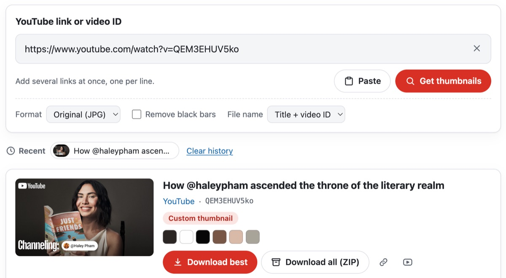
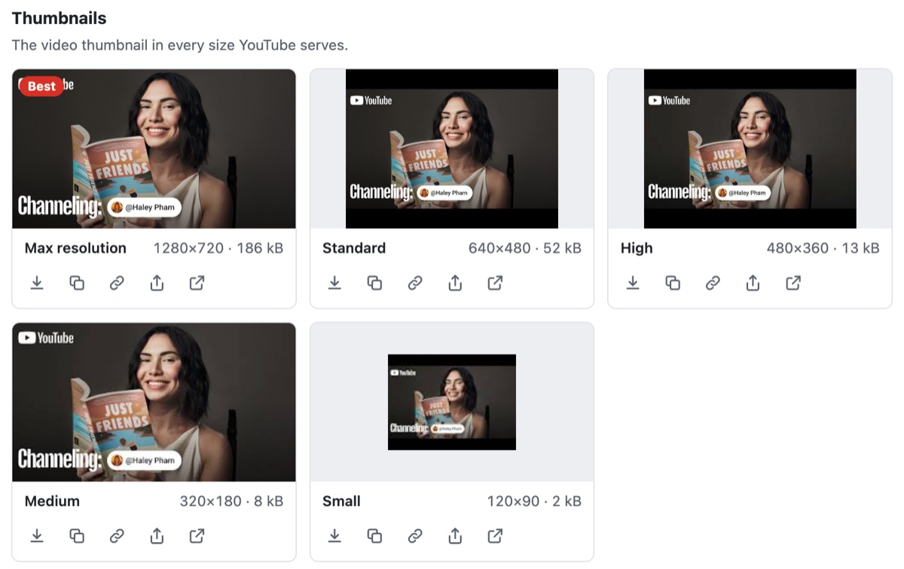
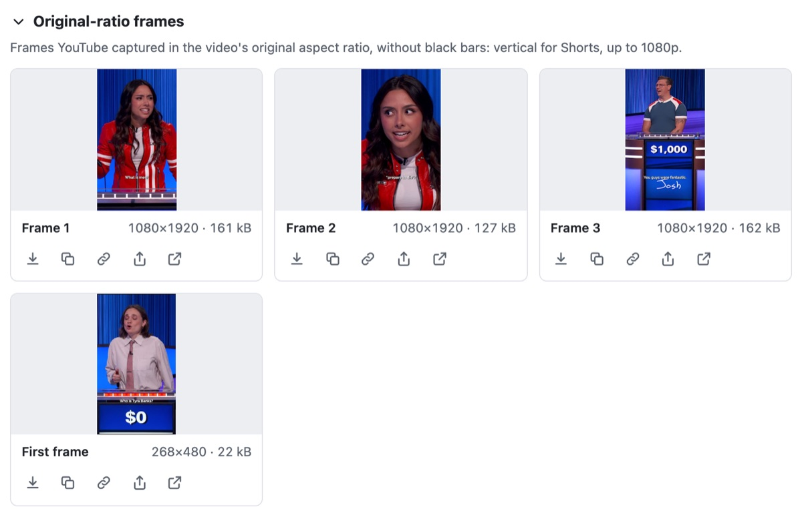
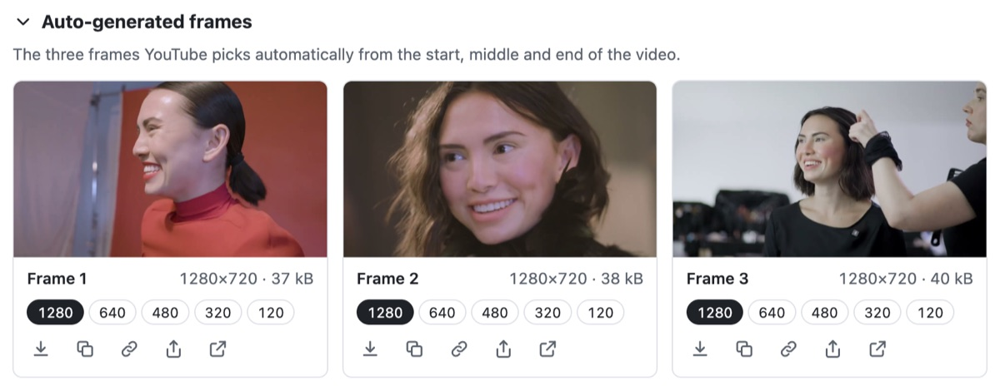
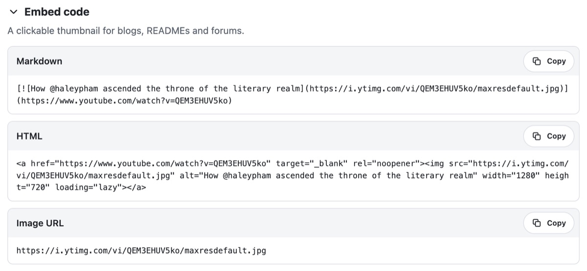

<p align="center"></p>

<h1 align="center">Extrator de miniaturas e fotogramas do YouTube para a web</h1>

<p align="center">
  
  
  
  
  <a href="../LICENSE"></a>
</p>

<p align="center"><a href="../README.md">English</a> · <a href="README.ko.md">한국어</a> · <a href="README.de.md">Deutsch</a> · <a href="README.es.md">Español</a> · <a href="README.fr.md">Français</a> · <a href="README.id.md">Bahasa Indonesia</a> · <a href="README.it.md">Italiano</a> · <a href="README.ja.md">日本語</a> · <a href="README.pl.md">Polski</a> · <a href="README.pt-BR.md">Português (Brasil)</a> · <b>Português (Portugal)</b> · <a href="README.vi.md">Tiếng Việt</a> · <a href="README.zh-Hans.md">简体中文</a> · <a href="README.zh-Hant.md">繁體中文</a></p>

Um componente web que recebe links do YouTube e encontra todas as imagens que o YouTube disponibiliza para cada vídeo
— a miniatura em todos os tamanhos, fotogramas na proporção do próprio vídeo e os fotogramas que o YouTube escolhe
sozinho — para transferir, copiar, converter ou guardar num ZIP. Funciona inteiramente no browser: sem servidor e sem
chave de API.

<p align="center"></p>

| Imagens | Ficheiros | Tamanho | Em que vídeos |
|---|---|---|---|
| Miniatura | `maxresdefault` · `sddefault` · `hqdefault` · `mqdefault` · `default`, e ainda `hq720` quando falta o `maxresdefault` | de 1280×720 a 120×90 | todos os vídeos; os tamanhos 4:3 têm barras pretas, e os vídeos carregados em baixa resolução não têm 1280×720 nem 640×480 |
| Fotogramas na proporção original | `oar1`–`oar3` e `frame0` (o primeiro fotograma) | 1080×1920 nos Shorts; nos restantes, até 1920×1080 | Shorts e vídeos mais antigos; os vídeos normais recentes só têm `frame0` |
| Fotogramas automáticos | `1`–`3` em cinco tamanhos; os maiores são `maxres1`–`maxres3` | de 1280×720 a 120×90 | todos os vídeos, exceto as transmissões em direto |
| Versões WebP | os tamanhos da miniatura, em `vi_webp` | os mesmos da miniatura | só são mostradas e abertas — o YouTube envia-as sem CORS |

O YouTube não indica quais destes ficheiros existem, por isso o ThumbSnap pede cada um e lê a resposta: um ficheiro
que não existe volta como um 404 com uma imagem cinzenta de 120×90 no lugar. Compara byte a byte a miniatura com os
fotogramas automáticos para distinguir uma miniatura carregada de uma gerada automaticamente, e obtém do endpoint
oEmbed do YouTube o título, o canal e se o vídeo é vertical. O que se descobriu ao sondar o YouTube está registado em
[docs/youtube-thumbnails.md](youtube-thumbnails.md).

A ferramenta está disponível em 14 idiomas — inglês, coreano, japonês, chinês (simplificado e tradicional), alemão,
espanhol, francês, italiano, português (de Portugal e do Brasil), polaco, indonésio e vietnamita — e segue o idioma da
página em que está. Em qualquer outro idioma, aparece em inglês. Também segue o modo escuro da página.

O código-fonte deste repositório está sob a licença MIT. O nome ThumbSnap e o seu ícone não fazem parte deste código.
O ícone no topo é mostrado apenas como referência: não está abrangido pela licença MIT, e o que for compilado a partir
deste repositório não o inclui. O ThumbSnap não tem qualquer ligação ao YouTube nem à Google, e as miniaturas
pertencem aos seus criadores.

## Experimentar

O ThumbSnap funciona em [hobbyworker.me](https://hobbyworker.me/pt/services/thumbsnap/), em todos os 14 idiomas.

## Requisitos

- Um browser atual: Chrome ou Edge 111 ou posterior, Safari 16.4 ou posterior, Firefox 113 ou posterior.
- Acesso a `i.ytimg.com` (imagens) e `www.youtube.com` (oEmbed). Não é contactado mais nenhum endereço.
- Para copiar imagens e partilhar, é preciso uma página segura — HTTPS ou `localhost`.

## Compilação

```sh
npm install
npm run dev     # a página de demonstração, com seletores de idioma e tema
npm test        # testes unitários (Vitest)
npm run build   # dist/thumbsnap.js, o respetivo source map e THIRD_PARTY_LICENSES.txt
```

A compilação e os testes foram verificados com o Node.js 24.

`dist/thumbsnap.js` é um único módulo ES que inclui o Lit e regista `<thumb-snap>` ao ser carregado. Distribua o
`THIRD_PARTY_LICENSES.txt` juntamente com ele.

## Como utilizar

1. Cole um ou mais links do YouTube ou IDs de vídeo. Funcionam links watch, `youtu.be`, Shorts, live, embed e
   `music.youtube.com`, e uma lista de reprodução traz o respetivo vídeo de capa. Um link colado é carregado de
   imediato; para vários, coloque um por linha, ou arraste um link e largue-o na ferramenta.
2. A miniatura aparece em todos os tamanhos que o YouTube tem, cada um com as dimensões reais e o tamanho do ficheiro,
   e o maior é assinalado como **Melhor**.
   <p align="center"></p>
3. Em **Fotogramas na proporção original** fica o que o YouTube captou no formato do próprio vídeo — no caso de um
   Short, três fotogramas verticais de 1080×1920 e o seu primeiro fotograma.
   <p align="center"></p>
4. Em **Fotogramas automáticos** ficam os três fotogramas que o YouTube escolhe sozinho; os números por baixo de cada
   um permitem alternar entre os seus cinco tamanhos.
   <p align="center"></p>
5. Cada imagem pode ser transferida, copiada como imagem, ter o endereço copiado, ser partilhada (quando o dispositivo
   permite partilhar ficheiros) ou ser aberta. **Transferir a melhor** e **Transferir tudo (ZIP)** aplicam-se ao vídeo
   inteiro; com vários vídeos, **Transferir todos os vídeos (ZIP)** coloca cada um numa pasta própria.
6. **Formato** converte para PNG ou WebP (só aparece o que o browser consegue codificar), **Remover barras pretas**
   recorta essas barras das imagens 4:3, e **Nome do ficheiro** usa o ID do vídeo, ou o título e o ID.
7. **Código de incorporação** gera Markdown e HTML para uma miniatura clicável. A barra de endereço mantém `?v=`, por
   isso um resultado pode ser partilhado, e os vídeos recentes ficam guardados no browser.
   <p align="center"></p>

## Como utilizar numa página web

```html
<script type="module" src="thumbsnap.js"></script>
<thumb-snap></thumb-snap>
```

| Atributo | Predefinição | |
|---|---|---|
| `locale` | o atributo `lang` mais próximo | `en` `ko` `ja` `zh-hans` `zh-hant` `id` `es` `fr` `pt` (Portugal) `pt-br` (Brasil) `vi` `de` `it` `pl`; as etiquetas de idioma como `zh-TW` ou `pt-BR` são associadas ao idioma correspondente |
| `theme` | `auto` | `auto` segue `data-theme`, `data-color-scheme` ou `data-bs-theme` no `<html>`, a respetiva classe `dark` ou `light`, ou o respetivo `color-scheme`, e depois o sistema; `light` e `dark` fixam o tema |
| `value` | | links ou IDs a carregar no início |
| `no-url-sync` | desativado | não altera `?v=` nem `?list=` na barra de endereço |
| `no-history` | desativado | não guarda vídeos recentes no `localStorage` |
| `max-videos` | `20` | o máximo de vídeos carregados de uma vez |

- Propriedades personalizadas de CSS: `--thumbsnap-accent`, `--thumbsnap-accent-hover`, `--thumbsnap-radius`,
  `--thumbsnap-font`.
- Cada ação dispara um evento `thumbsnap` com `bubbles` e `composed` ativados. O respetivo `detail` é
  `{ action, videoId?, variant?, format?, count? }`, e `action` é `resolve`, `download`, `download-zip`, `copy-image`,
  `copy-text`, `share` ou `error`.
- `load(text)` carrega links como se tivessem sido escritos; `clear()` limpa a ferramenta.

Uma subclasse pode dispor a ferramenta à sua maneira. `render()` é feito de duas partes — `renderTop()` (o campo do
link e as respetivas opções) e `renderBottom()` (os vídeos recentes, os resultados, a notificação e o visualizador de
imagens) — e cada parte traz o seu próprio espaçamento, por isso podem ser montadas de novo com o que quiser antes,
entre ou depois delas:

```js
import { ThumbSnapElement, defineThumbSnap, html } from './src/index.ts';

class MyThumbSnap extends ThumbSnapElement {
  render() {
    return html`${this.renderTop()}<slot name="between"></slot>${this.renderBottom()}`;
  }
}
defineThumbSnap('thumb-snap', MyThumbSnap);
```

`src/index.ts` não regista nada, por isso a subclasse pode usar o nome `thumb-snap`. Um slot vazio não ocupa espaço, e
o que lá colocar fica com o mesmo espaçamento do resto da ferramenta.

Os blocos de construção — `parseTarget`, `extractTargets`, `imageUrl`, `loadImage`, `fetchOEmbed`, `transformImage`,
`findContentRect`, `extractPalette`, `createZip` e outros — também são exportados, para utilização sem a interface.

## Estrutura

```
src/
├── core/       links, os ficheiros da CDN, carregamento e sondagem, oEmbed, recorte, conversão e cores, ZIP, nomes de ficheiro (sem interface)
├── i18n/       en (original), ko, ja, zh-hans, zh-hant, id, es, fr, pt, pt-br, vi, de, it, pl
├── ui/         o elemento <thumb-snap> (Lit) — o idioma e o tema da página, o estado de um vídeo, modelos, estilos
├── index.ts    a API pública; não regista nada
└── auto.ts     o ponto de entrada do bundle; regista <thumb-snap>
tests/          Vitest — links, ficheiros, ZIP, recorte, oEmbed, os catálogos, a escolha do melhor tamanho
docs/           o que o YouTube disponibiliza, e estes READMEs
index.html      a página de demonstração
```

Todos os catálogos têm as mesmas chaves e os mesmos marcadores de posição que `en.ts`; o verificador de tipos e os
testes garantem-no.

## Limitações

- O YouTube não documenta nenhum destes ficheiros. O que existe, e onde, pode mudar.
- Para distinguir uma miniatura carregada de uma automática, os bytes são comparados com `hq1`–`hq3`. Se o criador
  tiver escolhido outra das sugestões do Studio, a miniatura também parece ter sido carregada.
- Os ficheiros WebP do YouTube só podem ser abertos: sem CORS, a página não os consegue guardar nem converter.
  Converter um JPEG em WebP dá o mesmo resultado.
- Os ficheiros que precisam das assinaturas do YouTube — a capa vertical de um Short, pré-visualizações animadas,
  storyboards — e listas de reprodução ou canais inteiros ficam fora de alcance sem um servidor.
- Verificar ficheiros que não existem deixa erros 404 na consola do browser.
