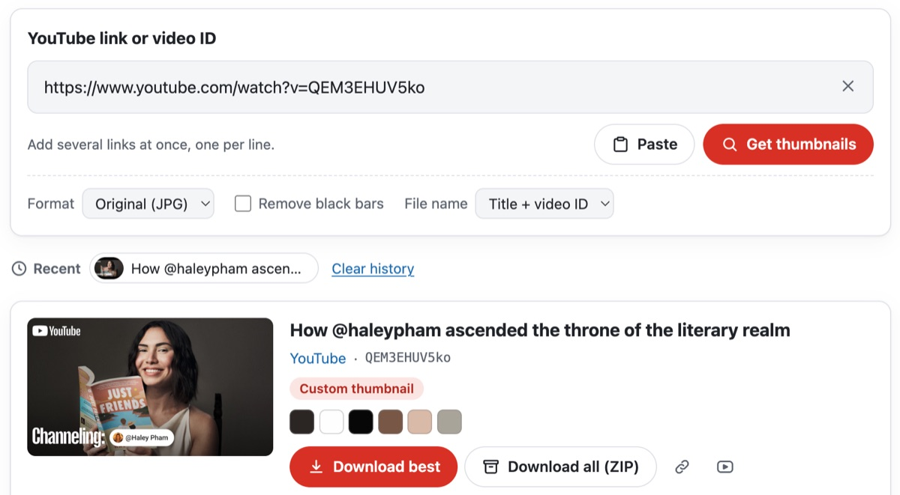
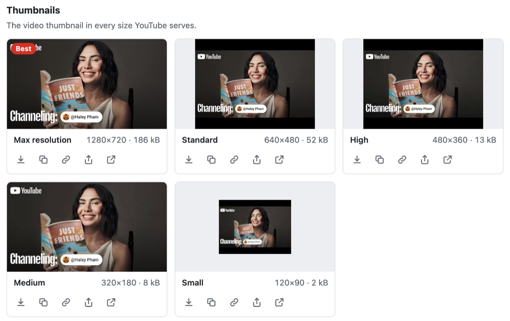
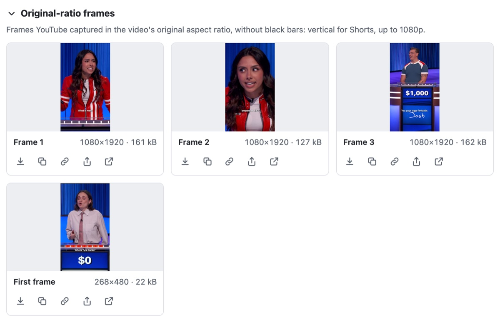
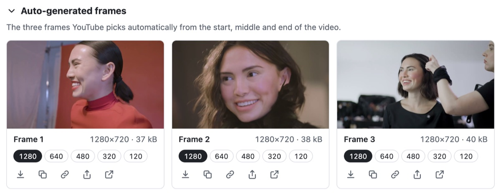
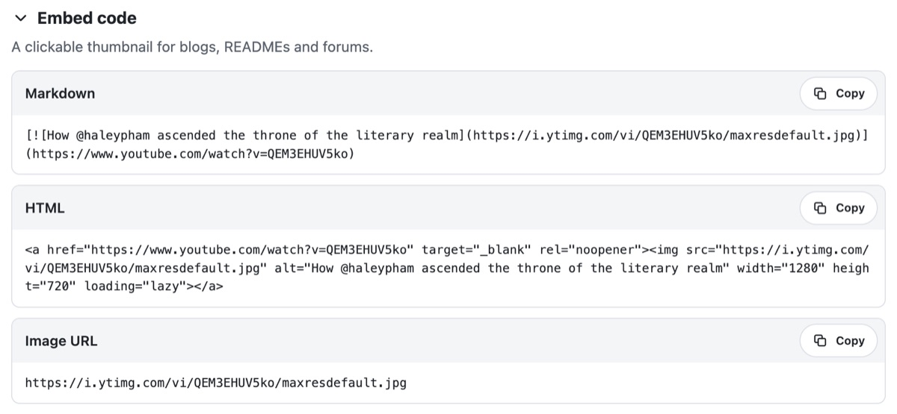

<p align="center"></p>

<h1 align="center">Извлечение превью и кадров YouTube для веба</h1>

<p align="center">
  
  
  
  
  <a href="../LICENSE"></a>
</p>

<p align="center"><a href="../README.md">English</a> · <a href="README.ko.md">한국어</a> · <a href="README.de.md">Deutsch</a> · <a href="README.es.md">Español (España)</a> · <a href="README.es-419.md">Español (Latinoamérica)</a> · <a href="README.fr.md">Français</a> · <a href="README.id.md">Bahasa Indonesia</a> · <a href="README.it.md">Italiano</a> · <a href="README.ja.md">日本語</a> · <a href="README.pl.md">Polski</a> · <a href="README.pt-BR.md">Português (Brasil)</a> · <a href="README.pt-PT.md">Português (Portugal)</a> · <b>Русский</b> · <a href="README.th.md">ไทย</a> · <a href="README.vi.md">Tiếng Việt</a> · <a href="README.zh-Hans.md">简体中文</a> · <a href="README.zh-Hant.md">繁體中文</a></p>

Веб-компонент, который принимает ссылки на YouTube и находит все изображения, которые YouTube отдаёт для
каждого видео, — превью во всех размерах, кадры в собственных пропорциях видео и кадры, которые YouTube
выбирает сам, — чтобы их можно было скачать, скопировать, преобразовать или сохранить в ZIP. Всё работает
прямо в браузере: без сервера и без ключа API.

<p align="center"></p>

| Изображения | Файлы | Размер | Для каких видео |
|---|---|---|---|
| Превью | `maxresdefault` · `sddefault` · `hqdefault` · `mqdefault` · `default`, а также `hq720`, если нет `maxresdefault` | от 1280×720 до 120×90 | все видео; у размеров 4:3 есть чёрные полосы, а у видео, загруженных в низком разрешении, нет 1280×720 и 640×480 |
| Кадры в исходных пропорциях | `oar1`–`oar3` и `frame0` (первый кадр) | 1080×1920 у Shorts, у остальных до 1920×1080 | Shorts и старые видео; у новых обычных видео есть только `frame0` |
| Автоматические кадры | `1`–`3` в пяти размерах, самые большие — `maxres1`–`maxres3` | от 1280×720 до 120×90 | все видео, кроме прямых трансляций |
| Версии WebP | размеры превью, в `vi_webp` | как у превью | только показываются и открываются — YouTube отдаёт их без CORS |

YouTube не сообщает, какие из этих файлов есть, поэтому ThumbSnap запрашивает каждый и смотрит на ответ:
отсутствующий файл приходит как 404 с серой заглушкой 120×90. Чтобы отличить загруженное превью от
автоматического, он побайтно сравнивает превью с автоматическими кадрами, а название, канал и то, вертикальное
ли видео, берёт из oEmbed YouTube. Что удалось выяснить, опрашивая YouTube, описано в
[docs/youtube-thumbnails.md](youtube-thumbnails.md).

Инструмент доступен на 17 языках — английском, корейском, японском, китайском (упрощённом и традиционном),
немецком, испанском (Испании и Латинской Америки), французском, итальянском, португальском (Португалии и
Бразилии), польском, русском, тайском, индонезийском и вьетнамском — и следует языку страницы, на которой
стоит. На других языках он показывается по-английски. Светлая или тёмная тема следует настройке устройства
или теме страницы, если страница её передаёт.

Исходный код в этом репозитории распространяется по лицензии MIT. Название ThumbSnap и его значок не входят в
этот код. Значок вверху показан только для справки: он не подпадает под лицензию MIT, и сборки из этого
репозитория его не содержат. ThumbSnap не связан с YouTube и Google, а превью принадлежат их авторам.

## Попробовать

ThumbSnap работает на [hobbyworker.me](https://hobbyworker.me/ru/services/thumbsnap/), на всех 17 языках.

## Требования

- Современный браузер: Chrome или Edge 111 и новее, Safari 16.4 и новее, Firefox 113 и новее.
- Доступ к `i.ytimg.com` (изображения) и `www.youtube.com` (oEmbed). Других адресов инструмент не запрашивает.
- Для копирования изображений и функции «Поделиться» нужна защищённая страница — HTTPS или `localhost`.

## Сборка

```sh
npm install
npm run dev     # демо-страница с переключателями языка и темы
npm test        # модульные тесты (Vitest)
npm run build   # dist/thumbsnap.js, его source map и THIRD_PARTY_LICENSES.txt
```

Сборка и тесты проверены на Node.js 24.

`dist/thumbsnap.js` — один ES-модуль, который включает Lit и при загрузке регистрирует `<thumb-snap>`.
Распространяйте вместе с ним `THIRD_PARTY_LICENSES.txt`.

## Как пользоваться

1. Вставьте одну или несколько ссылок на YouTube или ID видео. Подходят ссылки watch, `youtu.be`, Shorts,
   live, embed и `music.youtube.com`, а плейлист даёт видео со своей обложки. Вставленная ссылка загружается
   сразу; несколько ссылок вводятся по одной в строке, а ссылку можно и просто перетащить на инструмент.
2. Превью приходит во всех размерах, какие есть у YouTube, с реальными размерами изображения и файла, а самое
   большое отмечено как **Лучшее**.
   <p align="center"></p>
3. **Кадры в исходных пропорциях** — то, что YouTube сохранил в собственной форме видео: у Short это три
   вертикальных кадра 1080×1920 и его первый кадр.
   <p align="center"></p>
4. **Автоматические кадры** — три кадра, которые YouTube выбирает сам; числа под каждым переключают его пять
   размеров.
   <p align="center"></p>
5. Каждое изображение можно скачать, скопировать как изображение, скопировать его адрес, отправить через
   «Поделиться», если устройство умеет делиться файлами, или открыть. **Скачать лучшее** и **Скачать всё
   (ZIP)** охватывают всё видео; если видео несколько, **Скачать все видео (ZIP)** кладёт каждое в свою папку.
6. **Формат** преобразует в PNG или WebP (предлагается только то, что браузер умеет кодировать), **Убрать
   чёрные полосы** обрезает полосы у изображений 4:3, а **Имя файла** использует ID видео или название и ID.
7. **Код для вставки** даёт Markdown и HTML для кликабельного превью. В адресной строке остаётся `?v=`, так
   что результатом можно поделиться, а недавние видео сохраняются в браузере.
   <p align="center"></p>

## Как встроить в страницу

```html
<script type="module" src="thumbsnap.js"></script>
<thumb-snap></thumb-snap>
```

| Атрибут | По умолчанию | |
|---|---|---|
| `locale` | ближайший атрибут `lang` | `en` `ko` `ja` `zh-hans` `zh-hant` `id` `es` (Испания) `es-419` (Латинская Америка) `fr` `pt` (Португалия) `pt-br` (Бразилия) `vi` `de` `it` `pl` `ru` `th`; теги вроде `zh-TW` или `pt-BR` сопоставляются с нужным языком |
| `value` | | ссылки или ID, которые загрузятся при старте |
| `no-url-sync` | выключено | не трогает `?v=` и `?list=` в адресной строке |
| `no-history` | выключено | не хранит недавние видео в `localStorage` |
| `max-videos` | `20` | сколько видео загружается за раз, не больше |

- Светлая или тёмная тема задаётся CSS-свойством `color-scheme`, по умолчанию — настройкой устройства. Чтобы
  следовать тёмной теме страницы, задайте его элементу: `thumb-snap { color-scheme: inherit; }` берёт тему
  страницы, или `thumb-snap { color-scheme: dark; }`, пока страница тёмная. Браузеры без `light-dark()`
  (Chrome и Edge до 123, Firefox до 120, Safari до 17.5) показывают светлые цвета.
- Пользовательские свойства CSS: `--thumbsnap-accent`, `--thumbsnap-accent-hover`, `--thumbsnap-radius`,
  `--thumbsnap-font`.
- Каждое действие вызывает всплывающее событие `thumbsnap` с `composed`. Его `detail` —
  `{ action, videoId?, variant?, format?, count? }`, а `action` — `resolve`, `download`, `download-zip`,
  `copy-image`, `copy-text`, `share` или `error`.
- `load(text)` загружает ссылки так, будто их ввели вручную; `clear()` очищает инструмент.

Подкласс может сам расставить части инструмента. `render()` состоит из двух частей — `renderTop()` (поле для
ссылки и его настройки) и `renderBottom()` (недавние видео, результаты, уведомление и просмотрщик
изображений), — и у каждой части свои отступы, так что их можно собрать заново, поставив что угодно до, между
или после них:

```js
import { ThumbSnapElement, defineThumbSnap, html } from './src/index.ts';

class MyThumbSnap extends ThumbSnapElement {
  render() {
    return html`${this.renderTop()}<slot name="between"></slot>${this.renderBottom()}`;
  }
}
defineThumbSnap('thumb-snap', MyThumbSnap);
```

`src/index.ts` ничего не регистрирует, поэтому подкласс может занять имя `thumb-snap`. Пустой слот не занимает
места, а всё, что в него попадёт, получает те же отступы, что и остальной инструмент.

Строительные блоки — `parseTarget`, `extractTargets`, `imageUrl`, `loadImage`, `fetchOEmbed`,
`transformImage`, `findContentRect`, `extractPalette`, `createZip` и другие — тоже экспортируются, чтобы ими
можно было пользоваться без интерфейса.

## Структура

```
src/
├── core/       ссылки, файлы CDN, загрузка и проверка, oEmbed, обрезка, преобразование и цвета, ZIP, имена файлов (без интерфейса)
├── i18n/       en (исходный), ko, ja, zh-hans, zh-hant, id, es, es-419, fr, pt, pt-br, vi, de, it, pl, ru, th
├── ui/         элемент <thumb-snap> (Lit) — язык страницы, состояние одного видео, шаблоны, стили
├── index.ts    публичный API; ничего не регистрирует
└── auto.ts     точка входа бандла; регистрирует <thumb-snap>
tests/          Vitest — ссылки, файлы, ZIP, обрезка, oEmbed, каталоги, выбор лучшего размера
docs/           что отдаёт YouTube, и эти README
index.html      демо-страница
```

У всех каталогов те же ключи и подстановки, что и у `en.ts`; за этим следят проверка типов и тесты.

## Ограничения

- YouTube не документирует ни один из этих файлов. Что есть и где, может измениться.
- Загруженное превью отличают от автоматического, сравнивая байты с `hq1`–`hq3`. Если автор выбрал одно из
  других предложений Studio, превью тоже выглядит загруженным.
- Файлы WebP от YouTube можно только открыть: без CORS страница не может их сохранить или преобразовать.
  Преобразование JPEG в WebP даёт тот же результат.
- Файлы, которым нужны подписи YouTube, — вертикальная обложка Short, анимированные превью, раскадровки — и
  целые плейлисты или каналы без сервера недоступны.
- Проверка несуществующих файлов оставляет ошибки 404 в консоли браузера.
