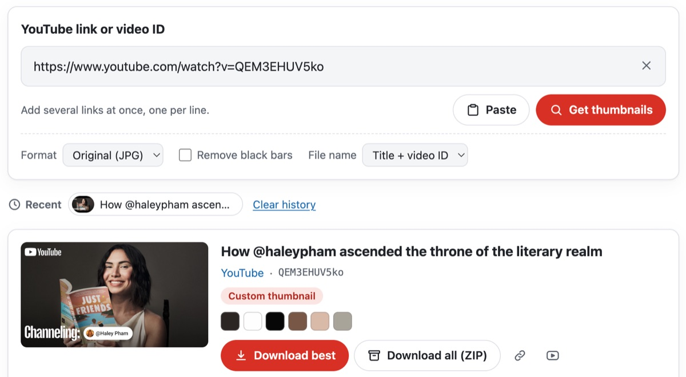
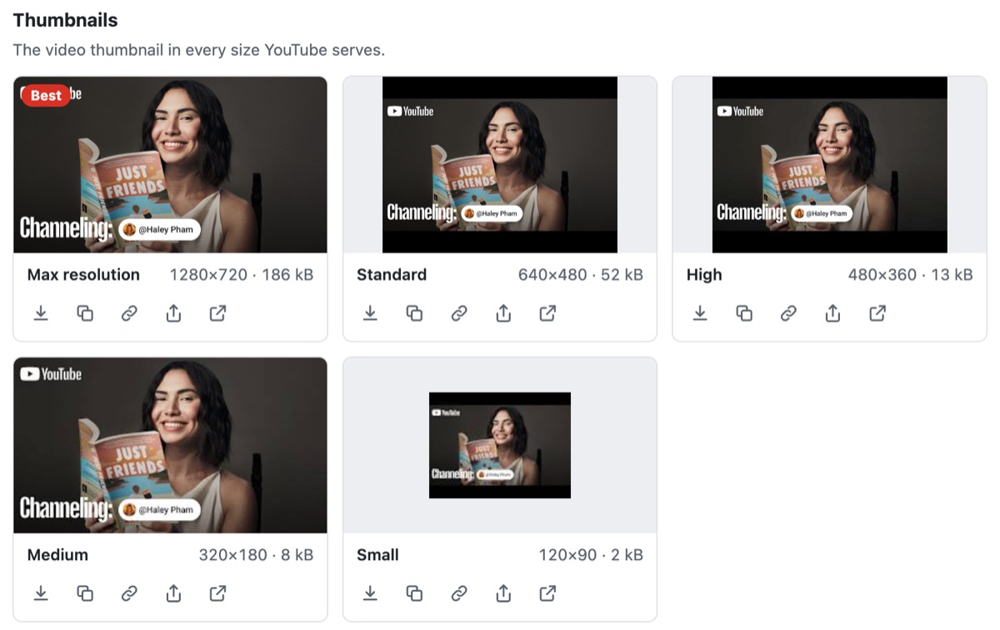
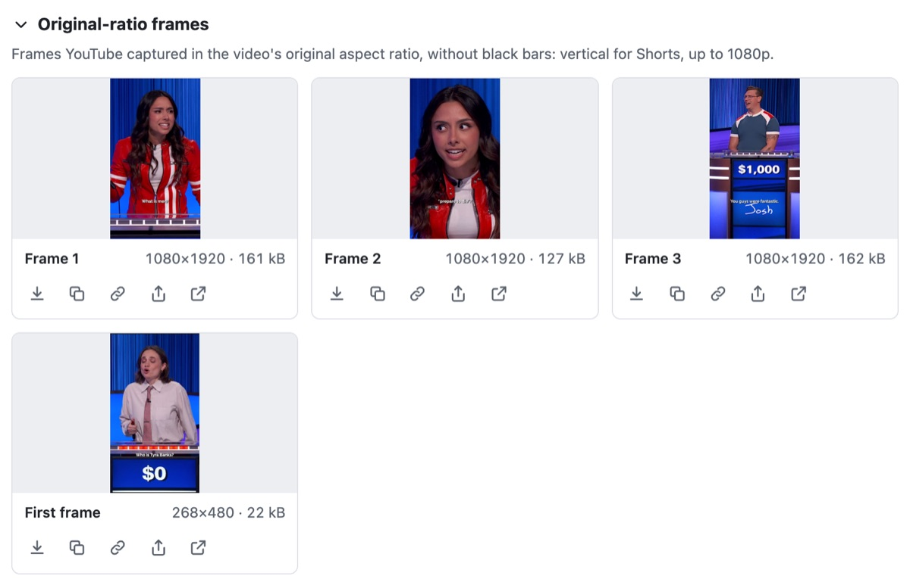
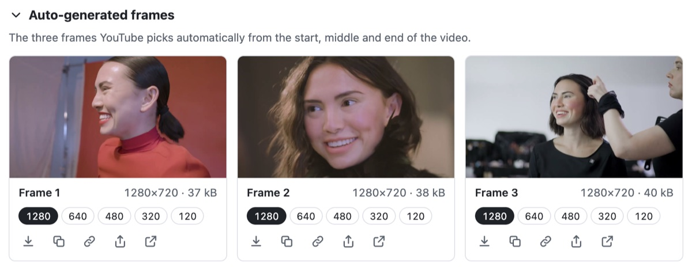
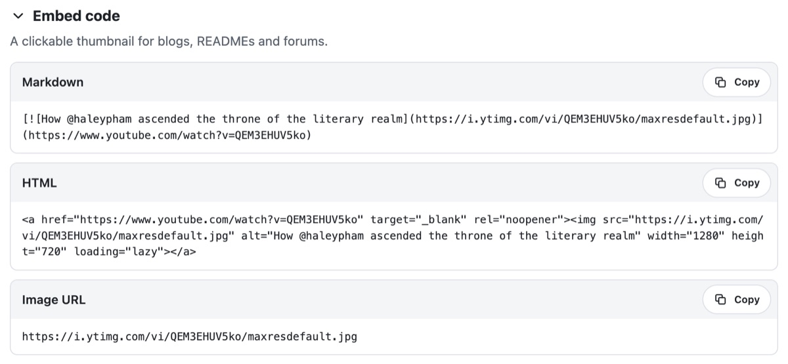

<p align="center"></p>

<h1 align="center">เครื่องมือดึงภาพขนาดย่อและเฟรมของ YouTube บนเว็บ</h1>

<p align="center">
  
  
  
  
  <a href="../LICENSE"></a>
</p>

<p align="center"><a href="../README.md">English</a> · <a href="README.ko.md">한국어</a> · <a href="README.de.md">Deutsch</a> · <a href="README.es.md">Español (España)</a> · <a href="README.es-419.md">Español (Latinoamérica)</a> · <a href="README.fr.md">Français</a> · <a href="README.id.md">Bahasa Indonesia</a> · <a href="README.it.md">Italiano</a> · <a href="README.ja.md">日本語</a> · <a href="README.pl.md">Polski</a> · <a href="README.pt-BR.md">Português (Brasil)</a> · <a href="README.pt-PT.md">Português (Portugal)</a> · <a href="README.ru.md">Русский</a> · <b>ไทย</b> · <a href="README.vi.md">Tiếng Việt</a> · <a href="README.zh-Hans.md">简体中文</a> · <a href="README.zh-Hant.md">繁體中文</a></p>

เว็บคอมโพเนนต์ที่รับลิงก์ YouTube แล้วค้นหาทุกภาพที่ YouTube มีให้สำหรับแต่ละวิดีโอ ทั้งภาพขนาดย่อทุกขนาด เฟรมตามสัดส่วนของวิดีโอเอง และเฟรมที่ YouTube เลือกเอง เพื่อดาวน์โหลด คัดลอก แปลง หรือบันทึกเป็น ZIP ทุกอย่างทำงานในเบราว์เซอร์ ไม่ต้องมีเซิร์ฟเวอร์และไม่ต้องใช้คีย์ API

<p align="center"></p>

| รูปภาพ | ไฟล์ | ขนาด | วิดีโอที่มี |
|---|---|---|---|
| ภาพขนาดย่อ | `maxresdefault` · `sddefault` · `hqdefault` · `mqdefault` · `default` และ `hq720` เมื่อไม่มี `maxresdefault` | ตั้งแต่ 1280×720 ถึง 120×90 | ทุกวิดีโอ ขนาด 4:3 มีแถบดำ และวิดีโอที่อัปโหลดด้วยความละเอียดต่ำไม่มี 1280×720 และ 640×480 |
| เฟรมสัดส่วนเดิม | `oar1`–`oar3` และ `frame0` (เฟรมแรก) | 1080×1920 สำหรับ Shorts วิดีโออื่นสูงสุด 1920×1080 | Shorts และวิดีโอเก่า วิดีโอทั่วไปที่เพิ่งลงมีแค่ `frame0` |
| เฟรมอัตโนมัติ | `1`–`3` ในห้าขนาด ใหญ่สุดคือ `maxres1`–`maxres3` | ตั้งแต่ 1280×720 ถึง 120×90 | ทุกวิดีโอยกเว้นไลฟ์สด |
| เวอร์ชัน WebP | ขนาดเดียวกับภาพขนาดย่อ อยู่ใน `vi_webp` | เท่ากับภาพขนาดย่อ | แสดงและเปิดได้เท่านั้น เพราะ YouTube ส่งมาโดยไม่มี CORS |

YouTube ไม่ได้บอกว่ามีไฟล์ใดบ้าง ThumbSnap จึงขอทีละไฟล์แล้วอ่านคำตอบ ไฟล์ที่ไม่มีจะได้ 404 พร้อมภาพสีเทาขนาด 120×90 มาแทน เครื่องมือเทียบภาพขนาดย่อกับเฟรมอัตโนมัติทีละไบต์เพื่อแยกภาพขนาดย่อที่อัปโหลดออกจากภาพที่สร้างอัตโนมัติ และดึงชื่อวิดีโอ ช่อง และข้อมูลว่าวิดีโอเป็นแนวตั้งหรือไม่จาก oEmbed ของ YouTube สิ่งที่พบจากการทดสอบกับ YouTube บันทึกไว้ใน [docs/youtube-thumbnails.md](youtube-thumbnails.md)

เครื่องมือนี้มี 17 ภาษา ได้แก่ อังกฤษ เกาหลี ญี่ปุ่น จีน (ตัวย่อและตัวเต็ม) เยอรมัน สเปน (สเปนและละตินอเมริกา) ฝรั่งเศส อิตาลี โปรตุเกส (โปรตุเกสและบราซิล) โปแลนด์ รัสเซีย ไทย อินโดนีเซีย และเวียดนาม และจะแสดงตามภาษาของหน้าที่วางไว้ ภาษาอื่นจะแสดงเป็นภาษาอังกฤษ ธีมสว่างหรือมืดเป็นไปตามการตั้งค่าของอุปกรณ์ หรือตามธีมของหน้าเมื่อหน้าส่งต่อมาให้

ซอร์สโค้ดในที่เก็บนี้ใช้สัญญาอนุญาต MIT ชื่อ ThumbSnap และไอคอนไม่ได้เป็นส่วนหนึ่งของซอร์สนี้ ไอคอนด้านบนแสดงไว้เพื่ออ้างอิงเท่านั้น ไม่อยู่ภายใต้สัญญาอนุญาต MIT และบิลด์จากที่เก็บนี้ไม่มีไอคอนนี้ ThumbSnap ไม่มีส่วนเกี่ยวข้องกับ YouTube หรือ Google และภาพขนาดย่อเป็นของผู้สร้างแต่ละราย

## ลองใช้

ThumbSnap ใช้งานได้ที่ [hobbyworker.me](https://hobbyworker.me/th/services/thumbsnap/) ครบทั้ง 17 ภาษา

## ข้อกำหนด

- เบราว์เซอร์รุ่นปัจจุบัน: Chrome หรือ Edge 111 ขึ้นไป, Safari 16.4 ขึ้นไป, Firefox 113 ขึ้นไป
- เข้าถึง `i.ytimg.com` (รูปภาพ) และ `www.youtube.com` (oEmbed) ได้ ไม่มีการติดต่อที่อื่น
- การคัดลอกรูปภาพและการแชร์ต้องใช้หน้าที่ปลอดภัย คือ HTTPS หรือ `localhost`

## การบิลด์

```sh
npm install
npm run dev     # หน้าสาธิต พร้อมตัวสลับภาษาและธีม
npm test        # unit test (Vitest)
npm run build   # dist/thumbsnap.js, source map และ THIRD_PARTY_LICENSES.txt
```

การบิลด์และการทดสอบตรวจสอบแล้วกับ Node.js 24

`dist/thumbsnap.js` เป็น ES module ไฟล์เดียวที่รวม Lit ไว้แล้ว และลงทะเบียน `<thumb-snap>` เมื่อโหลด ให้แจกจ่าย `THIRD_PARTY_LICENSES.txt` ไปพร้อมกัน

## วิธีใช้

1. วางลิงก์ YouTube หรือรหัสวิดีโออย่างน้อยหนึ่งรายการ ใช้ได้ทั้งลิงก์ watch, `youtu.be`, Shorts, live, embed และ `music.youtube.com` ส่วนเพลย์ลิสต์จะได้วิดีโอที่เป็นหน้าปก ลิงก์ที่วางจะโหลดทันที ถ้ามีหลายลิงก์ให้ใส่บรรทัดละลิงก์ หรือลากลิงก์มาวางบนเครื่องมือ
2. ภาพขนาดย่อจะแสดงทุกขนาดที่ YouTube มี พร้อมขนาดจริงและขนาดไฟล์ และภาพที่ใหญ่ที่สุดจะมีป้าย **ดีที่สุด**
   <p align="center"></p>
3. **เฟรมสัดส่วนเดิม** คือภาพที่ YouTube บันทึกไว้ตามรูปทรงของวิดีโอเอง สำหรับ Short คือเฟรมแนวตั้ง 1080×1920 สามเฟรมและเฟรมแรก
   <p align="center"></p>
4. **เฟรมอัตโนมัติ** คือสามเฟรมที่ YouTube เลือกเอง ตัวเลขใต้แต่ละเฟรมใช้สลับระหว่างห้าขนาด
   <p align="center"></p>
5. ทุกภาพดาวน์โหลด คัดลอกเป็นรูปภาพ คัดลอกที่อยู่ แชร์ (ถ้าอุปกรณ์แชร์ไฟล์ได้) หรือเปิดได้ **ดาวน์โหลดภาพที่ดีที่สุด** และ **ดาวน์โหลดทั้งหมด (ZIP)** ใช้กับทั้งวิดีโอ ถ้ามีหลายวิดีโอ **ดาวน์โหลดทุกวิดีโอ (ZIP)** จะแยกแต่ละวิดีโอไว้ในโฟลเดอร์ของตัวเอง
6. **รูปแบบ** แปลงเป็น PNG หรือ WebP (แสดงเฉพาะรูปแบบที่เบราว์เซอร์เข้ารหัสได้) **ตัดแถบดำออก** ตัดแถบดำของภาพ 4:3 และ **ชื่อไฟล์** ใช้รหัสวิดีโอ หรือชื่อเรื่องกับรหัส
7. **โค้ดสำหรับฝัง** ให้ Markdown และ HTML สำหรับภาพขนาดย่อที่คลิกได้ แถบที่อยู่จะเก็บ `?v=` ไว้ จึงแชร์ผลลัพธ์ได้ และวิดีโอล่าสุดจะเก็บไว้ในเบราว์เซอร์
   <p align="center"></p>

## การใช้ในหน้าเว็บ

```html
<script type="module" src="thumbsnap.js"></script>
<thumb-snap></thumb-snap>
```

| แอตทริบิวต์ | ค่าเริ่มต้น | |
|---|---|---|
| `locale` | แอตทริบิวต์ `lang` ที่ใกล้ที่สุด | `en` `ko` `ja` `zh-hans` `zh-hant` `id` `es` (สเปน) `es-419` (ละตินอเมริกา) `fr` `pt` (โปรตุเกส) `pt-br` (บราซิล) `vi` `de` `it` `pl` `ru` `th` แท็กอย่าง `zh-TW` หรือ `pt-BR` จะจับคู่กับภาษาที่ตรงกัน |
| `value` | | ลิงก์หรือรหัสที่จะโหลดตอนเริ่ม |
| `no-url-sync` | ปิด | ไม่แตะ `?v=` และ `?list=` ในแถบที่อยู่ |
| `no-history` | ปิด | ไม่เก็บวิดีโอล่าสุดใน `localStorage` |
| `max-videos` | `20` | จำนวนวิดีโอสูงสุดที่โหลดในครั้งเดียว |

- ธีมสว่างหรือมืดมาจาก CSS `color-scheme` ค่าเริ่มต้นคือการตั้งค่าของอุปกรณ์ ถ้าต้องการให้ตามโหมดมืดของหน้า ให้กำหนดให้องค์ประกอบ: `thumb-snap { color-scheme: inherit; }` จะใช้ตามหน้า หรือใช้ `thumb-snap { color-scheme: dark; }` ขณะที่หน้าเป็นธีมมืด เบราว์เซอร์ที่ไม่รองรับ `light-dark()` (Chrome และ Edge ก่อน 123, Firefox ก่อน 120, Safari ก่อน 17.5) จะแสดงสีของธีมสว่าง
- คุณสมบัติที่กำหนดเองของ CSS: `--thumbsnap-accent`, `--thumbsnap-accent-hover`, `--thumbsnap-radius`, `--thumbsnap-font`
- ทุกการกระทำจะส่งอีเวนต์ `thumbsnap` ที่ bubble และ composed โดย `detail` คือ `{ action, videoId?, variant?, format?, count? }` และ `action` เป็น `resolve`, `download`, `download-zip`, `copy-image`, `copy-text`, `share` หรือ `error`
- `load(text)` โหลดลิงก์เหมือนพิมพ์เข้าไปเอง ส่วน `clear()` ล้างเครื่องมือ

คลาสย่อยจัดวางเครื่องมือเองได้ `render()` ประกอบด้วยสองส่วน คือ `renderTop()` (ช่องใส่ลิงก์และตัวเลือก) และ `renderBottom()` (วิดีโอล่าสุด ผลลัพธ์ การแจ้งเตือน และตัวดูรูปภาพ) แต่ละส่วนมีระยะห่างของตัวเอง จึงประกอบกลับเข้าไปใหม่โดยใส่อะไรก็ได้ไว้ก่อน ระหว่าง หรือหลังได้:

```js
import { ThumbSnapElement, defineThumbSnap, html } from './src/index.ts';

class MyThumbSnap extends ThumbSnapElement {
  render() {
    return html`${this.renderTop()}<slot name="between"></slot>${this.renderBottom()}`;
  }
}
defineThumbSnap('thumb-snap', MyThumbSnap);
```

`src/index.ts` ไม่ได้ลงทะเบียนอะไร คลาสย่อยจึงใช้ชื่อ `thumb-snap` ได้ สล็อตที่ว่างไม่กินพื้นที่ และสิ่งที่ใส่ลงไปจะมีระยะห่างเหมือนส่วนอื่นของเครื่องมือ

ส่วนประกอบพื้นฐาน เช่น `parseTarget`, `extractTargets`, `imageUrl`, `loadImage`, `fetchOEmbed`, `transformImage`, `findContentRect`, `extractPalette`, `createZip` และอื่น ๆ ก็ส่งออกไว้ด้วย เพื่อใช้โดยไม่ต้องมีอินเทอร์เฟซ

## โครงสร้าง

```
src/
├── core/       ลิงก์ ไฟล์ของ CDN การโหลดและการตรวจ oEmbed การครอป การแปลงและสี ZIP ชื่อไฟล์ (ไม่มีอินเทอร์เฟซ)
├── i18n/       en (ต้นฉบับ), ko, ja, zh-hans, zh-hant, id, es, es-419, fr, pt, pt-br, vi, de, it, pl, ru, th
├── ui/         องค์ประกอบ <thumb-snap> (Lit) — ภาษาของหน้า สถานะของแต่ละวิดีโอ เทมเพลต สไตล์
├── index.ts    API สาธารณะ ไม่ได้ลงทะเบียนอะไร
└── auto.ts     จุดเริ่มต้นของบันเดิล ลงทะเบียน <thumb-snap>
tests/          Vitest — ลิงก์ ไฟล์ ZIP การครอป oEmbed แค็ตตาล็อก การเลือกขนาดที่ดีที่สุด
docs/           สิ่งที่ YouTube มีให้ และ README เหล่านี้
index.html      หน้าสาธิต
```

แค็ตตาล็อกทุกไฟล์มีคีย์และตัวยึดตำแหน่งเหมือน `en.ts` ตัวตรวจชนิดข้อมูลและการทดสอบคอยตรวจสอบให้

## ข้อจำกัด

- YouTube ไม่มีเอกสารเกี่ยวกับไฟล์เหล่านี้เลย สิ่งที่มีและตำแหน่งของไฟล์อาจเปลี่ยนได้
- การแยกภาพขนาดย่อที่อัปโหลดออกจากภาพที่สร้างอัตโนมัติทำโดยเทียบไบต์กับ `hq1`–`hq3` ถ้าผู้สร้างเลือกภาพแนะนำอื่นของ Studio ภาพนั้นจะดูเหมือนภาพที่อัปโหลดเช่นกัน
- ไฟล์ WebP จาก YouTube เปิดได้อย่างเดียว เพราะไม่มี CORS หน้าเว็บจึงบันทึกหรือแปลงไม่ได้ การแปลง JPEG เป็น WebP ให้ผลเหมือนกัน
- ไฟล์ที่ต้องใช้ลายเซ็นของ YouTube เช่น ภาพปกแนวตั้งของ Short ตัวอย่างแบบเคลื่อนไหว สตอรีบอร์ด รวมถึงเพลย์ลิสต์หรือช่องทั้งหมด จะเข้าถึงไม่ได้ถ้าไม่มีเซิร์ฟเวอร์
- การตรวจไฟล์ที่ไม่มีอยู่จะทิ้งข้อผิดพลาด 404 ไว้ในคอนโซลของเบราว์เซอร์
